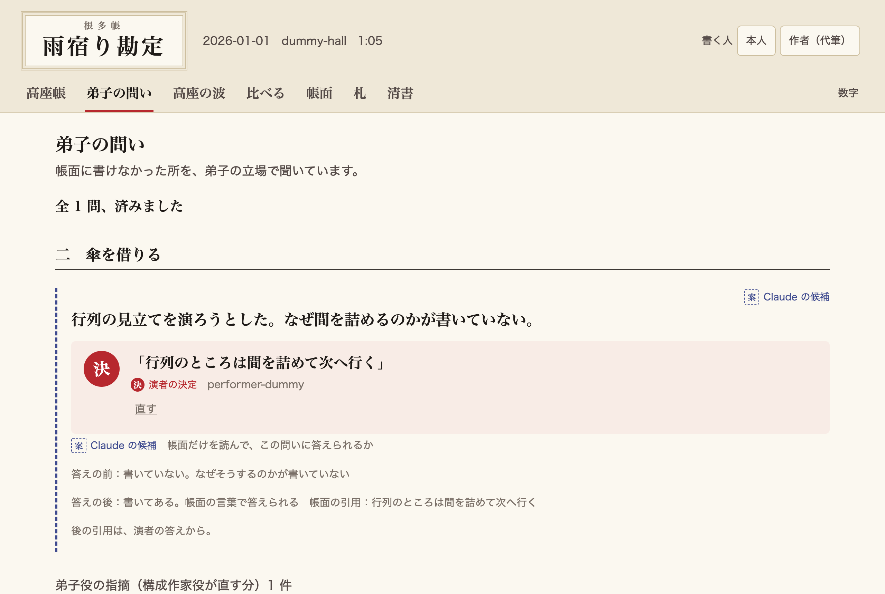
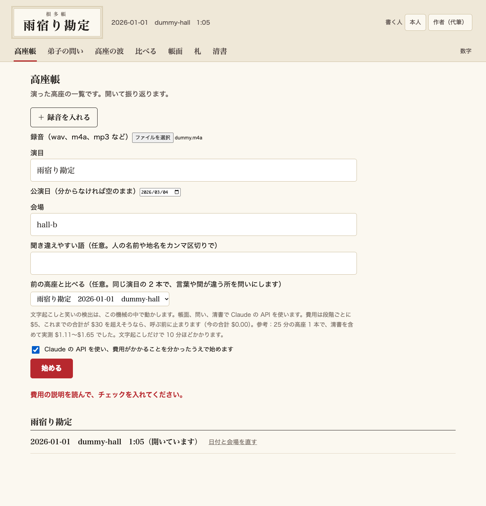
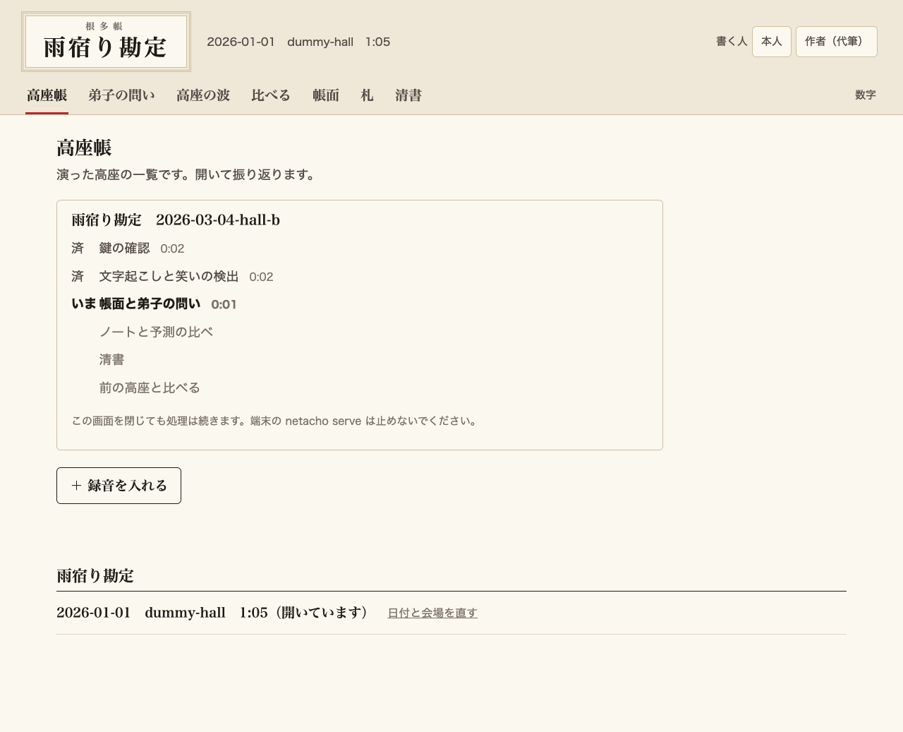
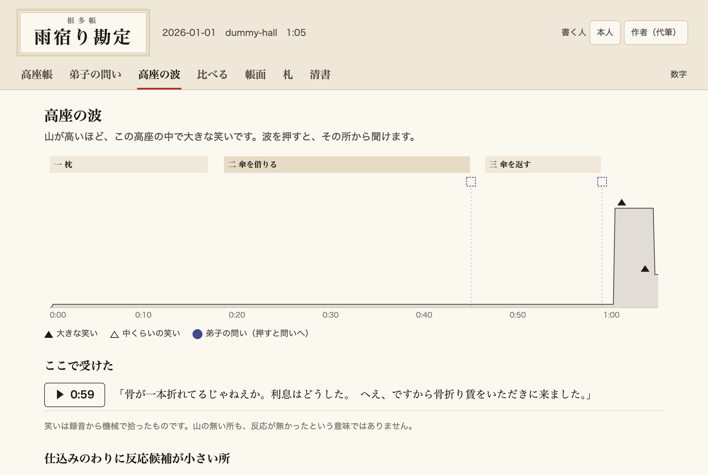

# 根多帳（Netacho）

**落語家が高座を振り返って、磨いた理由を帳面に残すためのツール。**

落語は、同じ噺を何度も高座にかけて磨く芸です。ところが、どこで受けたのか、なぜそこを変えたのかは書き残されず、録音があっても見返す方法がありません。根多帳に高座の録音を入れると、笑いの来た所が波で見え、別の日の高座や稽古と並べて比べられます。違いのあった所や、文字からは読めなかった笑いを、Claude が弟子の立場で本人に聞き、答えを本人の言葉のまま帳面に残します。決めるのは演者で、道具は候補と問いを出すだけです。



動画：（提出時に追記）

## 何を解くか

開発を始めるときに電話で、作り始めてからは画面を見せながら、現役の落語家 1 名に作者が聞き取りをしました（録音は repo に含めません）。高座のあとに「どこで受けたか」を振り返ることは無かった、と言います。ホールの人に「よく笑っていました」と言われても、天井が高かったり客席が遠かったりすると、本当のところは舞台からは分かりません。変えた理由は本人の頭の中にしか残らず、弟子や後輩が読める形にもなっていません。

根多帳は、録音を「見て、比べて、聞いて、残す」ための帳面にします。

1. **見る**：録音から文字と笑いの波を作ります。波を押すと、その場面だけ聞き返せます
2. **比べる**：同じ演目の別の日の高座や稽古と並べます。どの台詞が同じくだりかを Claude が読み、笑いと間はスクリプトが録音から測ります
3. **聞く**：2 本で言葉が違う所や、Claude が文字から笑いどころと読めなかった所を、弟子の立場で「なぜここを変えたのか」と本人に聞きます
4. **残す**：答えは書き換えずに型（この演者の演り方）へ残ります。次に問いを作るとき、Claude はこれまでの問いと答えも読み返し、答えた所は聞き直しません

ここでいう**帳面**は、噺（誰が演っても同じ筋）と型（この演者の演り方）の 2 冊です。

## 使い方

起動はコマンド 1 つで、その後はブラウザの中で済みます。端末のコマンドでも同じことができます（下の「端末で使う」）。

### 用意するもの

- macOS か Linux。ffmpeg（`brew install ffmpeg`）と [uv](https://docs.astral.sh/uv/)。Python 3.12 は uv が入れます
- 録音を処理するときだけ、Anthropic の API の鍵（`ANTHROPIC_API_KEY`）。見るのと答えるのには要りません

### 起動する

```
make setup                      # 依存を入れる
export ANTHROPIC_API_KEY=...    # 鍵は環境変数で渡す
uv run netacho serve            # ブラウザが開く。止めるときは Ctrl-C
```

鍵を `.env` に置いているときは、netacho は `.env` を自分では読まないので、uv に読ませて起動します。処理の各段階はサーバから鍵を受け継ぎます。

```
uv run --env-file .env netacho serve
```

演者のデータは repo の外の `~/netacho-data/` に置きます（`NETACHO_DATA` で変えられます）。演者は ID で扱い、既定は `performer-a` です（`--performer` で変えられます）。高座があれば、いちばん新しい高座を開きます。

### ブラウザでやること

1. **録音を入れる**：最初は「最初の高座を入れる」の画面が出ます。2 本目からは「高座帳」の「＋ 録音を入れる」を使います。録音のファイル、演目、公演日、会場を入れます。同じ演目名で入れると、同じ帳面に書き足されます。前の高座を選ぶと、2 本を比べる段階も続けて回ります
2. **費用を確かめて始める**：録音 1 本の上限（$5。サーバを止めない限り、やり直しも含めて数えます）、全体の上限（$30）、これまでの合計が出ます。チェックを入れてから始めます。上限を超えそうなときは、`budget.py` が呼ぶ前に止めます
3. **進み具合を見る**：鍵の確認 → 文字起こしと笑いの検出 → 帳面と弟子の問い → ノートと予測の比べ → 清書（→ 前の高座と比べる）の順に、今の段階と、かかった時間が出ます。画面を閉じても処理は続き、開き直すと続きが見えます。同時に動かすのは 1 本だけです。止まったら、止まった段階と「止まった所からやり直す」が出ます
4. **できた高座を開く**：右上で「書く人」（本人か、作者の代筆か）を選び、「弟子の問い」に答えます。答えは書き換えられずに型へ残ります。的外れの問いは理由を付けて捨てられます
5. **振り返る**：「高座の波」で笑いの来た所を見て、押すとその所から聞けます。「帳面」で噺と型、「札」で次の高座の前に見る札、「比べる」で 2 本の違い、「清書」で読める速記を見ます







録音は手元から出ません。文字起こし（Whisper）と笑いの検出（AST）は手元で動かします。Claude の API に送るのは、文字起こしの文と、そこから作った帳面や笑いの所の情報で、音声は送りません。初回はモデルのダウンロードに時間がかかります。時間と費用は、下の「数字」の表（25 分の高座の 2 回の実測）を見てください。

### ダミーで画面だけ見る

repo にはダミー（自作の架空の噺）だけが入っています。答えると書き込まれるので、写してから開きます。

```
make setup
make test
cp -r tests/fixtures/dummy_koza /tmp/netacho-dummy
NETACHO_DATA=/tmp/netacho-dummy uv run netacho serve --performer performer-dummy
```

### 端末で使う

画面でやることは、すべてコマンドでもできます。`--reuse` は、同じ入力の役の出力を使い回します（途中で落ちたときのやり直し用）。

```
netacho auth                                                  # API の鍵を確かめる（課金なし）
netacho run     --audio 録音 --performer ID --neta 演目 --koza 日付-会場
netacho seisho  --performer ID --neta 演目 --koza 日付-会場 --title 題 [--terms 語,語]  # 清書
netacho compare --performer ID --neta 演目 --koza 日付-会場 --with-koza 日付-会場2  # 同じ演目の 2 本を比べて問う
netacho answer  --performer ID --neta 演目 --question Q --speaker 名 --words 言葉
netacho reread  --performer ID --neta 演目 --koza 日付-会場     # 演者の判断が入った帳面を、弟子役に読み直させる
netacho recheck --performer ID --neta 演目 --koza 日付-会場     # 答えの前と後の帳面で、同じ問いを読み直す
netacho dismiss --performer ID --neta 演目 --question Q --speaker 名 --reason 理由
netacho decide  --performer ID --neta 演目 --speaker 名 --words 言葉 --card 札の文 --why 理由 --scene 場面
netacho guide   --performer ID --neta 演目                    # 札（LLM 0 回）
netacho view    --performer ID --neta 演目 --koza 日付-会場     # 画面用の JSON を out/view に書き出す
netacho serve   [--performer ID] [--neta 演目 --koza 日付-会場] [--port 8765]
```

## 仕組み

**流れを決めるのはスクリプト。Claude は意味を読む所だけ。決めるのは演者。**

```
録音 → 文字起こし（Whisper）、笑いの候補（AST）。どちらも手元で動く
  → 構成作家役：噺と型、笑いどころの予測（笑いは見ない）
  → 根拠の検証（スクリプト）→ 照合役 → マージ（演者の項目は上書きしない）
  → 弟子役：帳面だけを読み、演れない所を挙げる → 差し戻し（1 回まで）
  → 予測と笑いを比べる（スクリプト）。予測に無かった笑いを拾う → ノート役：演者への問い
  → 同じ演目の 2 本を比べる：対応づけ役が同じくだりを読み、スクリプトが笑いと間を測る
    → 聞き役：違いのあった所を弟子の立場で問う
  → 演者が答える → 型に残る → 次の問いで読み返す → 札（LLM 0 回）
  → 読み直し役：答えの前と後の帳面で、同じ問いに答えられるかを読む
```

| 役 | モデル | 読む物 | 読まない物 |
| --- | --- | --- | --- |
| 構成作家役 | Opus 5.5 | 文字起こし、演目名、既存の噺・型、差し戻し | 反応 |
| 照合役 | Sonnet 5.5 | 項目の文と引用だけ | 文字起こしの全体、演目名 |
| ノート役 | Sonnet 5.5 | 選ばれた候補、前後の引用、場面の尺、これまでの問いと答え | 反応の全体、型の全文 |
| 弟子役 | Opus 5.5 | 確定した帳面（噺・型の `.md`）だけ | 文字起こし、録音、反応、差し戻しの履歴 |
| 読み直し役 | Opus 5.5 | 答えの前か後の帳面、答えた問いの文 | 文字起こし、録音、反応 |
| 語の表役 | Opus 5.5 | 文字起こしの全文、演目の題、人物、演者から聞いた語 | 反応、型 |
| 速記役 | Opus 5.5 | 文字起こし、演目の題、人物、語の表、演者から聞いた語 | 反応、型 |
| 対応づけ役 | Opus 5.5 | 演目の題と、2 本の清書 | 反応、録音、型 |
| 聞き役 | Opus 5.5 | 笑いのあった所の種類、2 本の前後の台詞、実測の間、これまでの問いと答え | 録音、スコア、型の全文 |

表の「反応」は、機械が拾った笑いと拍手のことです。見せる物を分けるのがこの構成の要点です。構成作家役に反応を見せないので、予測の外れた所が「文字に無い芸」の候補になります。弟子役には帳面しか読ませないので、書けていない所がそのまま挙がります。聞き役も弟子の立場で問いを書きますが、読むのは 2 本の台詞と笑いの所、これまでの問いと答えで、型の全文は読みません。

## 数字

### 1 本の高座

手元の実録音（25 分 20 秒の高座。repo には含めません）を 2 回通した実測で、`run.json` の値です。項目と予測は実行ごとに変わるので、1 回の値ではなく 2 回を並べます。2 回目は、項目の文に内部の番号が残らないように直した後の版です。ノートと予測の比較は、2 回とも今の版でやり直しました。

| 項目 | 1 回目 | 2 回目 |
| --- | --- | --- |
| 文字起こし | 618 秒 | 558 秒 |
| AST（反応の検出） | 47 秒 | 70 秒 |
| Claude の役の費用（清書を除く） | $0.90 | $0.71 |
| Claude の役の時間（清書を除く） | 338 秒 | 259 秒 |
| 清書 | $0.21（Sonnet） | $0.94（Opus、演目の題を渡す。直さない語の約束を足す前の値） |
| 帳面の項目 | 62 件 | 58 件 |
| 根拠の検証を通った項目（延べ） | 71 件 | 63 件 |
| 根拠の検証で落とした項目 | 0 件 | 0 件 |
| 照合（言える / 一部だけ / 言えない） | 51 / 10 / 0 | 44 / 9 / 0 |
| 照合せずスクリプトが秒数で確かめた `間` | 7 件 | 7 件 |
| 演目の知識で照合しない項目 | 3 件 | 3 件 |
| 弟子役の指摘（1 周目 → 2 周目） | 9 → 3 | 6 → 4 |

延べの数には、差し戻しで書き直した項目も入るので、帳面の項目より多くなります。照合の 3 区分と `間`、知識の項目を足すと延べの数になります。費用と時間には、ノートのやり直しの分も入っています。根拠の検証は、4 分の抜粋では 33 件中 1 件を落としました（旧版の値）。全編の 2 回で落ちた項目はありません。

#### 文字だけの予測と、実際の笑い

構成作家役は反応を見ずに、文字だけで笑いどころを 24 か所ずつ予測しました。検出は 2 回とも同じです。

| 項目 | 1 回目 | 2 回目 |
| --- | --- | --- |
| 検出した笑い 5 か所のうち、予測の窓に入った数 | 2 か所 | 2 か所 |
| 笑いの山（弱い山を含む）20 個のうち、窓に入った数 | 10 個（50%） | 8 個（40%） |
| 同じ長さの窓を音声全体に一様に置いたときの見込み | 25.0% | 23.3% |

山は、AST の笑いのスコアが 0.08 以上で続く所です。見込みは、予測と同じ長さの窓を音声のどこかに一様に置いたとき、それぞれの山に触れる確率を、山の幅を入れて計算し、窓は独立に置くとして平均した値です。

一席だけの観察で、検定はしていません。山は 20 個で、2 回の差の 2 個は実行ごとのぶれです。見込みとの差が本物かどうかは言い切れません。下限の 0.08 はこの録音を見て決めた値で、2 回は同じ録音なので独立な確かめではありません。別の高座では確かめていません。笑いの 5 か所のうち 2 か所には比べる基準がありません。

耳での確認（同じ録音を作者が原音で実施。`run.json` にはありません）：検出した笑い 5 か所のうち 4 か所が実際の笑いで、外れの 1 つは演者の声の取り違えでした。この 1 か所は 2 回とも予測の窓の外です。見逃しは測っていません。母数は小さいです。

### 同じ演目の 2 本を比べる

本番と稽古の 1 組（どちらも手元の実録音）を比べた実測です。1 組だけの値で、ほかの組では確かめていません。詳しくは [報告書](docs/reports/2026-11-05-compare-two.md)。

| 項目 | 値 | 意味 |
| --- | --- | --- |
| 対応の付いた割合 | 100% | 短いほうの文字に対して。くだり 36、落とした数 0 |
| 聞き役が読んだ笑いの所 | 38 件 | 笑いのあった所は全部読ませ、聞く価値の順に選ばせる |
| 問い | 5 件 | 行の実在と間の実測はスクリプトが確かめる |
| 費用 | 対応づけ $0.21、問い $0.36 | 本番と稽古の 1 回 |
| 同じ録音を 2 本として比べたときの差 | 0 件 | 偽物の差が出ないことの確かめ |

最初は清書の文字で 2 本を揃えようとしましたが、本番と稽古では文字が 3% しか揃いませんでした。そこで、どの台詞が同じくだりかを Claude が読み、スクリプトがその対応の実在を確かめて笑いと間の実測を付ける形に作り替えました。

## Claude の使い方

- **見せない物を決める**：役ごとに別の文脈で呼び、読ませない物を決めています（上の表）。笑いを伏せて予測させ、外れた所を問いにします
- **意味は Claude、事実はスクリプト**：どの台詞が同じくだりか、どこを聞くかは Claude が読みます。区間の実在、笑いと間の実測、引用の実在はスクリプトが保存の前に確かめます
- **答えを次に活かす**：聞き役とノート役は、これまでの問いと答え、捨てた理由を読んでから問います。答えの言葉が 6 字以上続けて問いに入っていたら、スクリプトが落とします。言い換えは見ていません
- **LLM を呼ばない経路**：札はスクリプトが写すだけです。`decide`、`guide`、`view` のテストは `anthropic` を読み込めない状態で動かします
- **費用の上限**：`budget.py` が 1 回 $5、全体 $30 で、呼ぶ前に止めます

## 開発

開発期間は 4 日間（2026-11-05〜11-08）で、マージした PR は 41 本です（この PR を除く。2026-11-08 未明、日本時間の時点で、GitHub のマージ済みの PR を `gh pr list --state merged` で数えた値。初期の PR は題に番号を付けていないので、コミットの題の数とは合いません）。Claude Code を開発の中心にして、作り方そのものを仕組みにしました。

- **スキル**（`.claude/skills/`）：`/start`、`/pr`、`/report`、`/log` で、Issue から PR、報告書、日誌までの手順をそろえる
- **フック**（`.claude/hooks/`）：秘密のファイルや演者のデータへの書き込み、消す・書き換える操作、レビューの印が無い PR の作成を止める
- **サブエージェント**：文脈を持たない `reviewer` に、PR の前に差分を読ませる
- **自動レビュー**：PR ごとに Claude Code Review が走り、指摘は 3 周まで反映する

進め方と判断の理由は `progress.md` と `docs/reports/` に残しています。

## 限界

- 笑いの候補は機械的に拾ったものです。候補が無い所も、笑いが無かったという意味ではありません。演者の声を笑いと取り違えることがあります
- 文字起こしは聞き違いを含みます。清書の話者と直した語は推定で、原文を並べています
- 上下や仕草は録音から分かりません。演者の追記だけで入ります
- 笑いの閾値、間の上限などの数値は暫定です
- 同じ録音でも、実行ごとに項目と予測が変わります
- 噺の `knowledge` の項目は演目の知識で、照合していません。暫定と表示します
- 実録音で最後まで通したのは、端末の経路（`netacho run`、`netacho compare`）と、画面から録音を入れる経路です。画面からの経路は 2026-11-08 に作者が手元のブラウザで通しました。上の「数字」の表は端末の経路の実測です
- 2 本の比較の数字は、本番と稽古の 1 組の実測です
- 師匠の録音と比べるのは、同じ演目の 2 本を比べる仕組みをそのまま使う想定で、まだ試していません
- これまでの答えから問いの質が上がったかは、答えが溜まってから確かめます

## ライセンス

MIT

## 土台

開発の土台は、このハッカソンで先に始めた別プロダクト Soegaki（非公開）から流用しています。

## 出典

反応の検出に次のモデルとデータセットを使っています。

- AST：Yuan Gong, Yu-An Chung, James Glass. "AST: Audio Spectrogram Transformer". ICASSP 2021. https://arxiv.org/abs/2104.01778
- モデル：`MIT/ast-finetuned-audioset-10-10-0.4593`。https://huggingface.co/MIT/ast-finetuned-audioset-10-10-0.4593
- AudioSet：Jort F. Gemmeke ほか. "Audio Set: An ontology and human-labeled dataset for audio events". ICASSP 2017. https://research.google.com/audioset/
