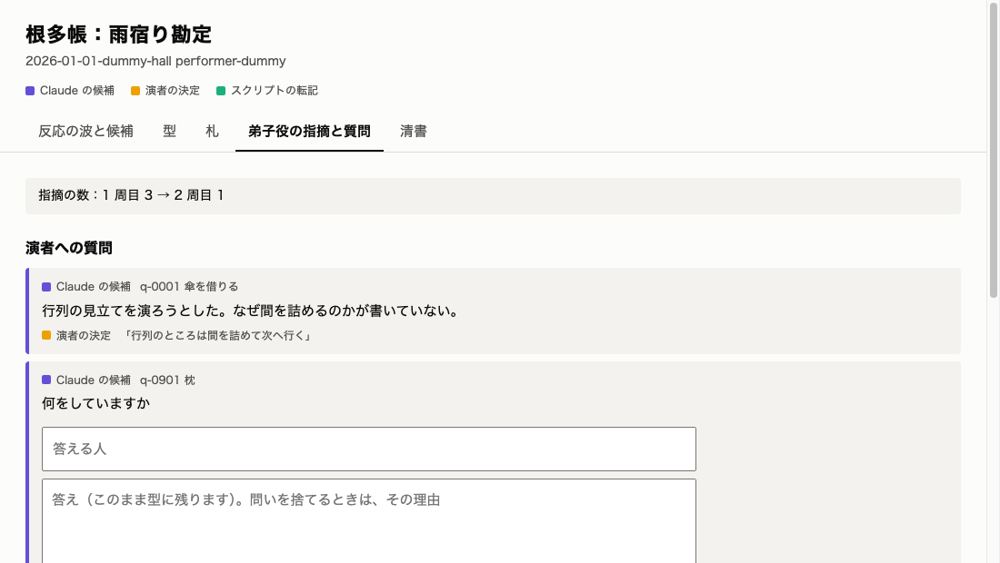

# 演者が画面で問いに答える

## 要旨

- 演者がコマンドを打たずに、画面で問いに答え、的外れの問いを捨てられるようにした
- 実の高座で演者本人に使ってもらう確認は、まだしていない
- 判断をお願いしたいことは 1 件（マージの指示）

## 何を狙って、どういう順で作ったか

問いに答えるには CLI が要り、演者本人には使いにくかった。根多帳は演者の答えが型に残って初めて役に立つので、README の次に作った。全編の結果で、検出の誤りから生まれた問いがあると分かったので、捨てる手段も足した。

## 到達点

| 誰が | 何をする | 結果 |
| --- | --- | --- |
| 演者 | `netacho serve` の URL を開いて答える | 答えが演者の言葉のまま型に残り、札と画面が更新される |
| 演者 | 的外れの問いを捨てる | 型には入らず、ノートをやり直しても同じ問いは戻らない |
| 開発者 | `make viewer` で見る | 今までどおり読むだけ。答える欄は出ない |
| 別のサイト | 書き込みを試みる | トークン、Host、Origin の確認で止まる |

画面の例（ダミーの高座）：

## 主な判断と、その理由

| 判断 | 理由 |
| --- | --- |
| 依存を足さず、Python の標準の HTTP サーバで作る | 手元で演者が答えるだけ。提出まで時間が限られる |
| 書き込みは `netacho answer` と同じ `performer` を通す | 演者の言葉を上書きしない約束と、後処理を 1 か所に保つ |
| 受け付けは並列、書き込みは鍵で 1 件ずつ | ブラウザの空の接続で画面が止まらず、帳面の読み書きも重ならない |
| 保存できた後の失敗は「保存しました」と伝える | 演者が同じ答えを送り直さないように |
| 捨てた問いの指摘は解決にして残す | 消すと、ノートのやり直しで同じ問いが戻る |

## 数字（実測）

| 項目 | 値 | 意味 |
| --- | --- | --- |
| テスト | 661 件成功 | LLM なしで動くことも確かめる |
| 本物の Chrome での確認 | 答える、捨てるの両方 | ダミーの高座で入力から保存、画面の更新まで |
| reviewer の指摘 | 7 件。反映 7 | |

## 判断・用意をお願いしたいこと

1. **マージの指示**：「マージして」と言ってもらえれば Squash でマージする

## リスク

| リスク | 現状 | 対策 |
| --- | --- | --- |
| 演者本人が迷わず使えるか | 未確認 | 実の高座で本人に試してもらう |
| 同じ機械の他のプロセスが view.json を読める | `make viewer` と同じ | 手元の機械で使う前提を plan に書いた |

## 次の計画

- 11/5〜11/6：実の高座で答えを試す。動画の用意へ進む

## 付録：技術的な記録

- Issue：#38
- 書き込みの確認は、起動ごとのトークン（独自のヘッダ）、Host、Origin、Content-Type。本文は 64 KB まで。応答とログに演者の言葉を出さない
- reviewer で直したもの：保存後の失敗の扱い、捨てる処理の途中で落ちたときのやり直し、reread で捨てた場面を問い直さない、接続の timeout、ファイルが無いときの応答、答えの後処理の共通化、plan の説明
- 自動レビュー 1 周目（3 件）：反映 3（エラーの後に応答が続くバグ、本文を鍵の外で読む、答える人の名前をタブの間だけ残す）
- CLAUDE.md の「読み書きは CLI だけ」は変えていない。`serve` は CLI のサブコマンドなので範囲に入ると考えた。判断は progress.md に残した
