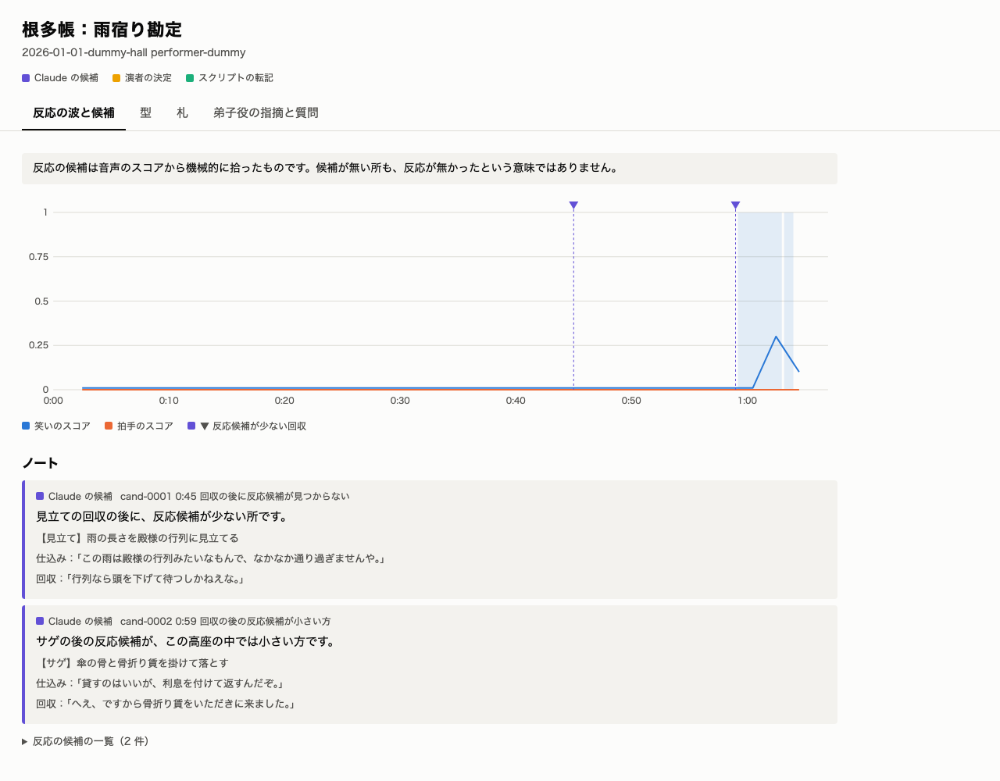
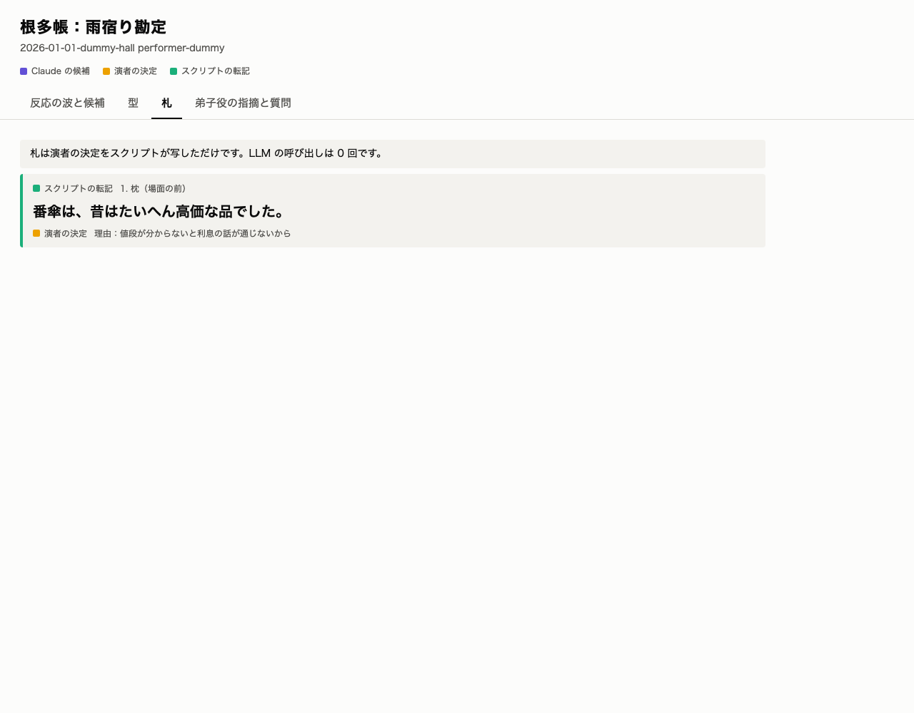

# T9 視聴画面

## 要旨

- `netacho view` と `make viewer` で、4 枚の画面を見られるようになった。ダミーのデータで確かめた
- 動画に使える画面の形はできた。実データの見え方は API の認証の後で確かめる
- 判断をお願いしたいことは 1 件（ポートの確認）

## 何を狙って、どういう順で作ったか

動画の見せ場を映す画面。審査の「デモ」に直結する。「誰が書いたか」を色とラベルで見分けられることが要点。

## 到達点

| 画面 | 見える物 |
| --- | --- |
| 反応の波と候補 | 笑いと拍手のスコア、反応の帯、反応候補が少ない回収、ノート |
| 型 | 噺と型の項目。根拠の引用。演者の言葉と理由。保留 |
| 札 | スクリプトが写した札。LLM 0 回と明記 |
| 弟子役の指摘と質問 | 指摘の数の 1 周目 → 2 周目、質問、演者の答え |

これは設計どおりの画面で、画像はすべてダミーのデータ。

## 主な判断と、その理由

| 判断 | 理由 |
| --- | --- |
| 色に加えて必ず文字のラベルを付ける | 色だけに頼らない。3 色は配色の検査を通した |
| 笑いと拍手は同じ軸で描く | 2 軸にすると比較を誤らせる。笑いの山は低く見えるが、高座の中の山は帯で示す |
| 文字はすべて `textContent` で入れる | 演者の言葉を HTML として解釈しない |
| 音声は書き出さない | 演者の録音を repo の下に置かない |

## 数字（実測）

| 項目 | 値 | 意味 |
| --- | --- | --- |
| テスト（macOS） | 474 件成功 | |

## 判断・用意をお願いしたいこと

1. **ポートの確認**：この Mac ではポート 8000 を VS Code が使っていて、`http://localhost:8000` に別の画面が出た。`make viewer PORT=8765` で避けられる

## リスク

| リスク | 現状 | 対策 |
| --- | --- | --- |
| `out/view/view.json` に演者のデータが入る | `.gitignore` の `out/` で除外。plan どおり | 動画の撮影の後に中身を確かめる |

## 次の計画

- API の認証の後：抜粋で一巡し、実データで画面を確かめる

## 付録：技術的な記録

- Issue：#19
- 注記：最初の撮影で、ポート 8000 の別の画面（別プロダクト）を撮ってしまった。コミットの前に気づいて消し、空いているポートで撮り直した。後始末に `pkill -f 'http.server -d . 8000'` を実行したが、ポート 8000 の VS Code のプロセスは動き続けていて、止めたのは自分で立てたサーバーだけと判断している
