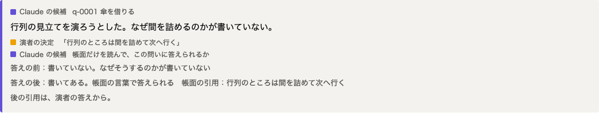

# 答えの前後の読み直し（#57）

## 要旨
- 演者の答えで帳面の理由が読めるようになったかを、同じ問いで答えの前後を読ませて確かめられるようにした
- テストは偽の応答で通した。実の API では読み直し役をまだ動かしていない
- 判断をお願いしたいことは 2 件

## 何を狙って、どういう順で作ったか
提出の締切は 2026-11-08 20:00 で、審査では動画と GitHub の中身が一致しているかも確かめられる。動画の台本は「答えが入る前は書いていない、入った後は読める」と語るが、コードは答えると指摘を解決にするだけで、同じ問いの前後を比べていなかった。語りを弱めるより、小さな実装で語りの裏付けを作れると判断し、既存の読み直しの部品の上に足した。

## 到達点

| 誰が | 何をする | 何が起きる |
|---|---|---|
| 演者 | 弟子の問いに答える | 今まで通り、答えが帳面に入る |
| 作者 | `netacho recheck` を打つ | 読み直し役が、答えの前の帳面と後の帳面を別々に読む |
| スクリプト | 引用が帳面にあるかを確かめる | 無い判定は落として数える。保存する |
| 演者、作者 | 問いの画面を見る | 前後の判定と、後の引用が答えから取られたかが出る |

次の画像はダミーの高座の画面。表示の確認用に手で書いた結果で、Claude の判定ではない。

## 主な判断と、その理由
- **問いごとでなく帳面ごとに読ませる:** 呼び出しが 2 回で済む。問いの数で費用が増えない
- **役にどちらの帳面かを教えない:** 「後なら読めるはず」という期待で判定が動くのを防ぐ
- **答えから読めたと数える条件を絞る:** 引用が答えから取られ、前の帳面に無いときだけ数える。語りを支える数字なので、甘く数えない
- **結果は作らない:** 前で読めた、後で読めなかった場合も、そのまま残して見せる

## 数字（実測）

| 値 | 意味 |
|---|---|
| `make test` 862 件通過 | 偽の応答で確かめた範囲。読み直し役の判定の質は測っていない |
| 文脈なしレビューの指摘 7 件 | 反映 6、見送り 1 |

費用と判定の質は、実の API で動かしていないので未測定。

## 判断・用意をお願いしたいこと
1. API キーのある環境で、ダミーか実データに `netacho recheck` を動かす。無いと、語り 8 番を前後の比較で語れない
2. 結果を見て、語り 8 番を確定する。前後の差が出なければ「足りない所を見つけて、本人に聞く」に変える

## リスク

| リスク | 現状 | 対策 |
|---|---|---|
| 実データで前後の差が出ない | 未確認 | 結果を作らず、語りを変える（#57） |
| 問いの文に理由の手がかりがあり、前でも読めたと判定される | 役の文で禁じたが、効果は未確認 | 実データの結果を読む |
| 画面の作り直しと衝突する | #60 が同じ `viewer/index.html` を変える | 先にマージされた側に合わせて取り込む |

## 次の計画
- 2026-11-06：PR のレビューを反映し、実の API で動かして語りを決める

## 付録：技術的な記録
- Issue：#57
- 追加：`netacho/recheck.py`、`roles/rechecker.md`、`schemas/rechecker.json`、`schemas/recheck.json`、`tests/test_recheck.py`
- 文脈なしレビューで見送った 1 件：`max_tokens` の上限。答えた問いは数件で、上限に当たれば `call_role` が止めるので、実測してから決める
- 注記：読み直し役には札の行も渡る。弟子役の読む `.md` と同じ形に揃えたため、plan の表を実態に合わせた
- 注記：ダミーの `kata.json` の答えの項目に `question_id` が無かったので 1 行足した
