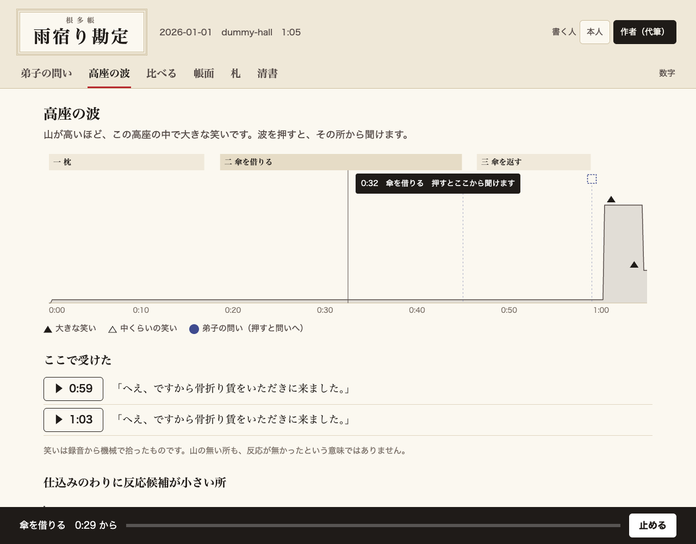

# 画面を帳面の見た目に作り直す（#60、#50）

## 意図
演者本人が使う画面にする。文字ばかりで無機質だった画面を帳面らしくして、最初に問いへ答えられるようにした。波は、どこで受けたかが一目で分かる形にした。

## 判断
- 清書のある所は清書だけを見せる。原文はデータに残す。ユーザーの判断で、plan §4 も直した
- タブの呼び方は「弟子の問い」にした
- 書く人は「本人」「作者（代筆）」から選ぶ。既定は置かない。代筆が「本人」で残ると、演者の決定の出所が偽りになるため
- 予測の的中や費用は「数字」タブへ移した。演者が次の高座を決めるのに要らないため
- 波の下に「ここで受けた」を出す。場面ごとに 3 つまでにして、枕だけで埋まらないようにした
- 「この答えを札にもする」は入れない。型に同じ言葉が 2 行入るため
- 拍手の線は波から外した。一覧は「数字」タブに残した

## 数字
- `make test` 853 件、すべて通過
- 実物の画面をブラウザで操作した確認（ダミーの一式）：書く人が未選択なら保存しない、答える、捨てる、札に出す、波を押して聞く（/clip が 206）。画面のエラー 0 件

## 依頼
- 本物の録音で、音の位置が合っているかを耳で確かめてください
- 動画の撮影スクリプトは、答える前に「本人」を押す 1 行が要ります。予測の数字は「数字」タブへ移りました

## 付録
- 場面の時刻は、この高座の timeline と transcript から `view.py` が出す。この高座に無い場面は時刻なし
- 別の高座が出所の項目は、この高座の録音で鳴らさない
- タブの id は動画の撮影のために変えていない

